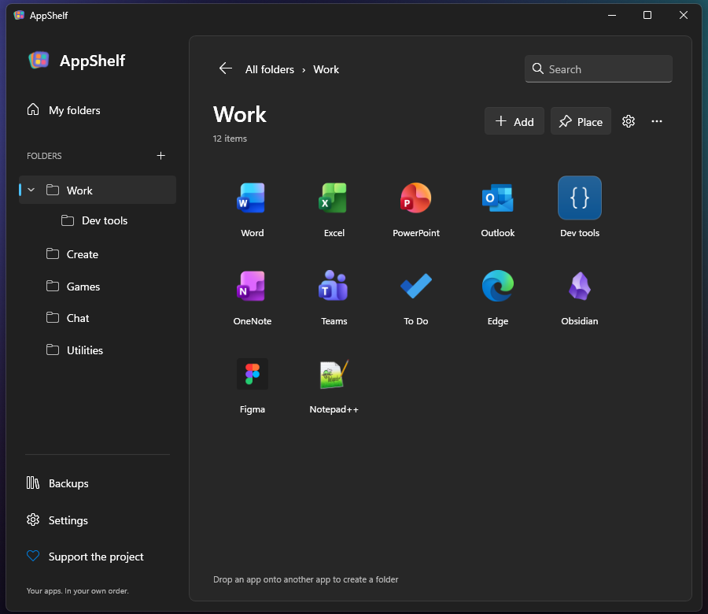
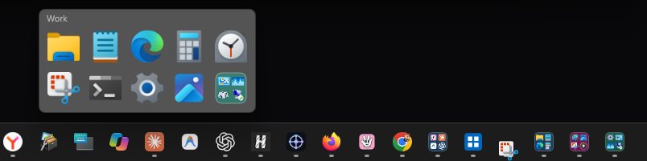
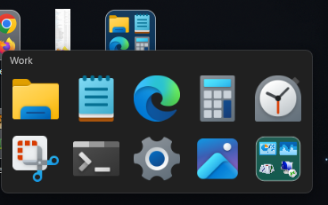
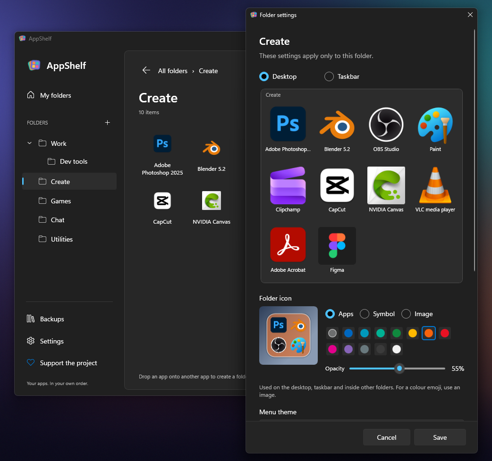

<p align="center"></p>
<h1 align="center">AppShelf</h1>
<p align="center">Your Windows apps. A little more organized.</p>
<p align="center">
  <a href="https://github.com/bertelfeed/AppShelf/actions/workflows/build.yml"></a>
  
  
  
  
  
  
</p>
<p align="center"><a href="README.ru.md">Русский</a> · <a href="MCP.md">MCP setup</a> · <a href="CONTRIBUTING.md">Build & contribute</a> · <a href="PRIVACY.md">Privacy</a></p>

https://github.com/user-attachments/assets/0296c093-1db0-49cc-9b3c-024e50979659

Put your apps into folders that open from the **taskbar or the desktop**. The menu stays small:
a title, your app icons and nested folders. Everything else lives in the editor.

**0.6.1 is a development preview; the first stable release will be 1.0.** The interface is
in **English and Russian**. Switch it in **Settings → Language**, and the change applies at once.
A new profile follows the Windows language and falls back to English.



## Features

- **Taskbar and desktop.** Each folder can sit on the taskbar, on the desktop, or both.
- **Taskbar previews** of each folder's apps, with quick-launch buttons.
- **Nested folders** in compact acrylic menus, and a Mica editor.
- **Your own layout:** rows, columns, pages, labels, light or dark menus and separate icon
  sizes for the desktop and the taskbar.
- **Folder icons** from app previews, a symbol or your own picture, with any background
  color and opacity.
- **Drag and drop** apps into menus, reorder them, or drop one onto a nested folder.
- **Shortcuts that keep working:** AppShelf keeps copies of imported shortcuts and finds
  apps that moved after an update.
- **Optional MCP server:** let Claude or another MCP client organize your apps. There is no
  chatbot inside AppShelf.



The four buttons on the taskbar are AppShelf folders, each with a preview of its apps.



The same folder on the desktop. These are real Windows 11 screenshots of a demonstration
collection; other apps' taskbar buttons are hidden.

## Get it

Requires **Windows 11 x64**. The ZIP includes .NET, so there is nothing else to install.

Download `AppShelf-<version>-win-x64.zip` and its SHA-256 checksum from
[Releases](https://github.com/bertelfeed/AppShelf/releases). Builds of every change are in the
[build artifacts](https://github.com/bertelfeed/AppShelf/actions/workflows/build.yml);
GitHub may ask you to sign in to download them. There is no stable release yet.

1. Extract the whole `AppShelf` folder to a permanent place you can write to.
2. Start `AppShelf.exe` and create a folder.
3. Add apps or drag shortcuts into it.
4. Click **Place** to show it on the desktop, the taskbar, or both.
5. Use the folder's gear button for its look and layout.

Taskbar buttons and single-click desktop icons work while AppShelf runs in the notification
area. Closing the editor only hides it; quitting AppShelf removes its taskbar buttons until it
starts again. Starting with Windows is optional. These are buttons of a running app, not
Explorer pins, and the Start menu is left untouched.

Click outside a menu or press **Esc** to close it. The nested folder's title, Backspace or
Alt+Left go back. A folder with more apps than fit turns pages with the mouse wheel, the
navigation keys or the page dots.

## Make it yours



Each folder keeps its own settings. Desktop and taskbar menus scale from 50 to 200%; Windows
itself decides how large the folder's icon is on those surfaces. A picture you choose is copied
into the profile, so moving the original does not break the folder icon.

## Updates

When a newer release is out, the editor shows a notice above **Backups**. The ZIP version asks
GitHub for its latest release, and the Microsoft Store version asks the Store. The check runs a
minute after start and then once a day. It never downloads anything by itself, and
**Settings → Check for updates** turns it off.

## Optional AI organization

`AppShelf.Mcp.exe` gives your MCP client local tools: list apps, create nested folders, move
items, change folder artwork and undo edits. Tidying the desktop is explicit and reversible:
only shortcuts move into the profile's archive, while documents and app folders stay in place.

The client sees desktop file names and paths. AppShelf itself calls no AI service and needs no
API key. See [MCP setup and privacy](MCP.md).

## Build from source

Windows and a stable **.NET 10 SDK**:

```powershell
./build.ps1 -Check
./build.ps1 -Check -Package
```

The second command publishes into a fresh folder and creates
`artifacts/AppShelf-<version>-win-x64.zip` with its `.sha256` file, without profiles or debug
symbols. Add `-Msix` to build the Microsoft Store package from the same binaries in the same
run. To update a local portable copy instead, quit its processes, keep its `data` folder and run
`./build.ps1 -Publish`.

## Data and profiles

- **ZIP version:** `portable.flag` keeps all data in `data` next to the executables.
- **Without `portable.flag`:** `%LOCALAPPDATA%/AppShelf`.
- **Microsoft Store version:** `%LOCALAPPDATA%/Packages/<package>/LocalState`. On its first start
  it takes over an existing `%LOCALAPPDATA%/AppShelf` profile.

`--import-profile <folder>` copies another profile, such as a portable `data` folder, into an
empty one. The source stays as it was, including archived shortcuts, and existing files are never
overwritten. After importing into another installation, recreate desktop shortcuts with
**Place** so they start the new copy. `--data-dir` selects a separate profile.

Back up **the whole data folder**, including copied launchers and pictures, before replacing the
program files. Saves are atomic, and the previous state is kept in `shelf.json.bak`. Removing an
item from AppShelf never uninstalls its app.

## On the way to 1.0

Still to check by hand: real Explorer clicks and drags, sleep and resume, mixed-DPI monitors and
accessibility. See [verification and manual QA](docs/VERIFICATION.md). There is no installer or
code-signing certificate yet. The MSIX package builds and passes its checks, but Store
installation, updates and sign-in startup still need testing in an installed package.

GitHub releases can send updates to Microsoft Store after a one-time Partner Center setup. This
is prepared and switched off until then; see [Store publishing setup](docs/STORE-PUBLISHING.md).

The history is rebuilt as [five development checkpoints](docs/HISTORY.md). Code and assets were
written independently; no AppGroup source code was copied.

## Feedback

[Report a bug](https://github.com/bertelfeed/AppShelf/issues/new?template=bug_report.yml),
[suggest a feature](https://github.com/bertelfeed/AppShelf/issues/new?template=feature_request.yml)
or [ask a question](https://github.com/bertelfeed/AppShelf/issues/new?template=question.yml), in
English or Russian. Opening an issue needs a GitHub account. **Report a bug** is also in the app's
Settings, next to **Rate in Microsoft Store** once AppShelf is in the Store.

## Support

If AppShelf saves you time, you can support its development on
[Boosty](https://boosty.to/bertelfeed/donate). The same link is in the app.

## License

[MIT](LICENSE), © 2026 bertelfeed. Bundled Microsoft .NET and WPF components keep their own
notices in `licenses/` and [THIRD-PARTY-NOTICES.txt](THIRD-PARTY-NOTICES.txt).
