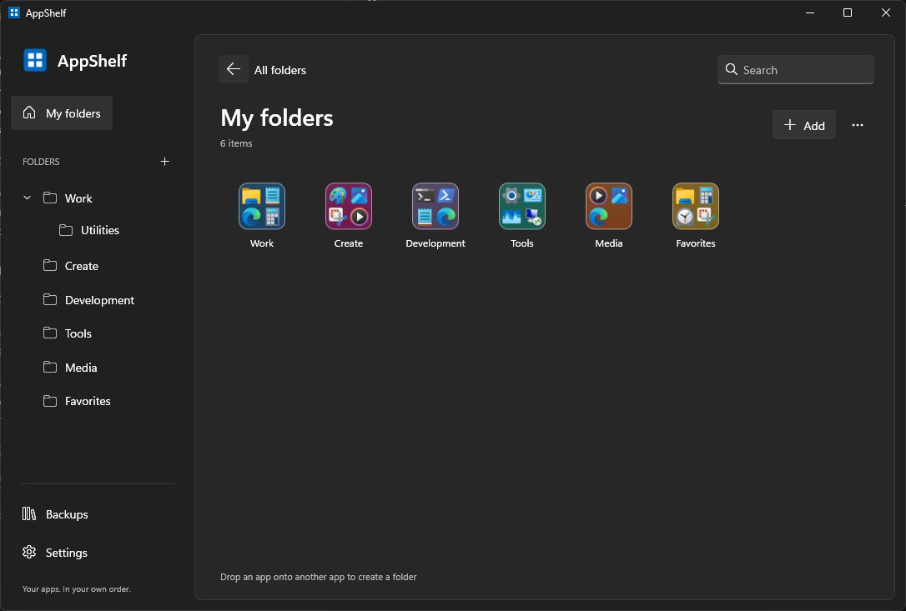
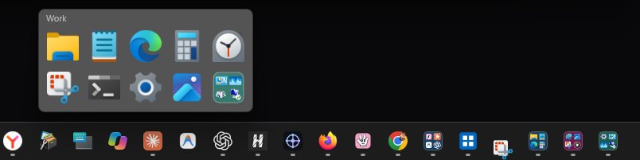
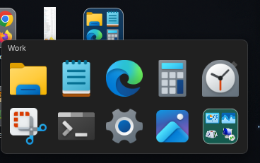
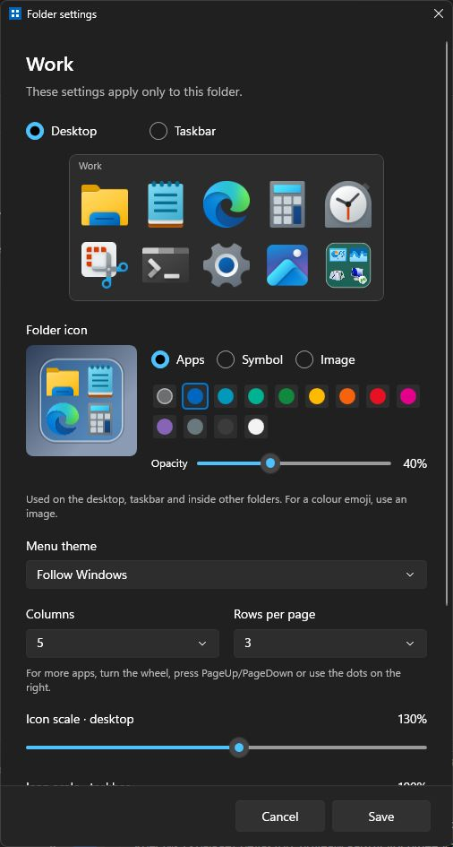

# AppShelf · 0.6.0

**Папки приложений для рабочего стола и панели задач Windows 11.**

[English](README.md) · [Подключение MCP](MCP.md) · [Сборка и участие](CONTRIBUTING.md)



Это предварительная версия **0.6.0**. Первый стабильный релиз планируется как **1.0**.
Полноценный интерфейс на **английском и русском**. Язык меняется в
**Параметры → Язык**, применяется без перезапуска и сохраняется.
Новый профиль использует язык Windows: русский или английский для остальных языков.

## Возможности

- Папки внутри папок, компактные меню с акрилом и редактор с Mica.
- Каждую папку можно разместить на рабочем столе, панели задач или в обоих местах.
- Свои настройки каждой папки: тема, строки, столбцы, подписи, поведение закрытия
  и отдельный масштаб иконок для двух мест запуска.
- Страницы меню: колесо, клавиши и вертикальные точки справа.
- Перетаскивание приложений, вставка между иконками и вложение в папку.
- Значок из приложений, символа или картинки; цвет и непрозрачность подложки.
- Превью содержимого папки и быстрый запуск на панели задач.
- Копирование ярлыков в профиль, поиск переместившихся программ и починка после обновлений.
- MCP-сервер: раскладка приложений через выбранный ИИ-клиент, без чата внутри AppShelf.



Три значка с превью справа — кнопки папок AppShelf на панели задач Windows.



Та же папка на рабочем столе. Это настоящие снимки Windows с демонстрационной коллекцией.

## Запуск

Нужна **Windows 11 x64**. В portable-сборку включён .NET.
Предварительные сборки находятся в [артефактах Windows build](https://github.com/bertelfeed/AppShelf/actions/workflows/build.yml);
для скачивания GitHub может попросить вход. Стабильного релиза пока нет.

Распакуйте всю папку AppShelf в постоянное место и запустите `AppShelf.exe`.
Создайте папку, добавьте приложения и нажмите **«Разместить»**. Шестерёнка рядом — её
собственные настройки. Меню закрывается кликом снаружи или Esc; название вложенной
папки, Backspace и Alt+← возвращают назад.

**Кнопки панели задач и одинарный клик рабочего стола требуют работающего AppShelf.**
Крестик скрывает редактор; полный выход доступен у значка в трее. При выходе кнопки
папок исчезают, при запуске восстанавливаются. Автозапуск включается по желанию.
Это кнопки работающего приложения; системное меню «Пуск» не изменяется.



## Сборка

Windows и стабильный .NET 10 SDK:

```powershell
./build.ps1 -Check
./build.ps1 -Check -Package
```

Вторая команда собирает отдельный portable ZIP с контрольной суммой SHA-256,
без пользовательского профиля. Для обновления своей папки: завершите приложение
и MCP-процессы, сохраните всю `data`, затем выполните `./build.ps1 -Publish`.

В portable-режиме профиль находится в `data` рядом с exe; иначе — в
`%LOCALAPPDATA%/AppShelf`. При обновлении сохраните всю папку, включая картинки и
копии ярлыков. Удаление элемента из AppShelf не удаляет программу или документ.

## До релиза 1.0

Остались ручные проверки настоящих кликов и перетаскивания Explorer, сна,
разных DPI и доступности. Подробности — [проверки](docs/VERIFICATION.md).
Установщика, цифровой подписи и автоматического обновления пока нет.

История оформлена в [пять восстановленных этапов](docs/HISTORY.md).
Код и ресурсы AppGroup не переносились.

## Лицензия

[MIT](LICENSE), copyright 2026 bertelfeed. У компонентов Microsoft .NET/WPF
свои уведомления — [THIRD-PARTY-NOTICES.txt](THIRD-PARTY-NOTICES.txt) и `licenses/` в сборке.
